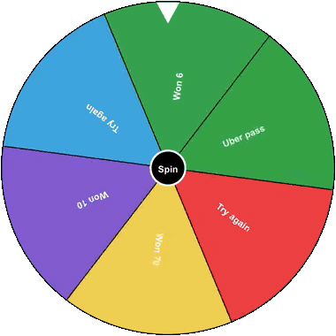

# spin-wheel-game

[](https://www.npmjs.com/package/spin-wheel-game)
[](https://www.npmjs.com/package/spin-wheel-game)
[](https://github.com/Ajay-Maury/spin-wheel-game)
[](LICENSE)

A customizable spin wheel (prize wheel / wheel of fortune) component for React. Click the wheel and it spins, ticks, slows down and tells you which segment it landed on.

## Demo

<p align="center">
  
</p>

Try the [live demo](https://spin-wheel-game-rho.vercel.app/). It has a playground where you can change the props, the full docs, and the release notes.

## Features

- Random result on every spin
- Any number of segments (2 or more), each with its own text and color
- Shrinks to fit its container, so it works on phones (`responsive`)
- Optional tick sound while spinning
- Accessible: keyboard support, screen-reader label and announced result
- Start a spin from your own button with a ref (`clickToSpin`, `spin()`)
- Written in TypeScript, typings included
- Works with React 18 and newer, and several wheels can share a page

Use it for prize draws, giveaways, raffles, lucky draws, random pickers and game-style "spin to decide" screens.

## Installation

```bash
npm install spin-wheel-game
```

Requires React 18 or newer.

## Usage

```jsx
import React from 'react';
import { SpinWheel, ISpinWheelProps } from 'spin-wheel-game';

const segments = [
  { segmentText: 'Option 1', segColor: 'red' },
  { segmentText: 'Option 2', segColor: 'blue' },
  { segmentText: 'Option 3', segColor: 'green' },
  // Add more segments as needed
];

const MySpinWheel: React.FC = () => {
  const handleSpinFinish = (result: string) => {
    console.log(`Spun to: ${result}`);
    // Handle the result as needed
  };

  const spinWheelProps: ISpinWheelProps = {
    segments,
    onFinished: handleSpinFinish,
    primaryColor: 'black',
    contrastColor: 'white',
    buttonText: 'Spin',
    isOnlyOnce: false,
    size: 290,
    upDuration: 100,
    downDuration: 600,
    fontFamily: 'Arial',
    arrowLocation: 'top',
    showTextOnSpin: true,
    isSpinSound: true,
    responsive: true,
    clickToSpin: 'wheel',
  };

  return <SpinWheel {...spinWheelProps} />;
};

export default MySpinWheel;
```

## Props

| Prop | Type | Default | Description |
| --- | --- | --- | --- |
| `segments` | `{ segmentText: string; segColor?: string }[]` | required | The wheel segments. Needs at least 2 with text. Segments without `segColor` use `primaryColor`. |
| `onFinished` | `(result: string) => void` | required | Called with the winning `segmentText` when the wheel stops. |
| `primaryColor` | `string` | `'black'` | Color of the wheel outline and center button. |
| `contrastColor` | `string` | `'white'` | Color of the text and the needle. |
| `buttonText` | `string` | `'Spin'` | Text in the center button. |
| `isOnlyOnce` | `boolean` | `false` | Allow only one spin. |
| `size` | `number` | `290` | Wheel radius in pixels. The canvas is `size * 2` wide. |
| `upDuration` | `number` | `100` | Spin-up time in ms per segment. |
| `downDuration` | `number` | `600` | Spin-down time in ms per segment. |
| `fontFamily` | `string` | `'Arial'` | Font for the segment text and result. |
| `arrowLocation` | `'center' \| 'top'` | `'center'` | Where the needle is drawn. |
| `showTextOnSpin` | `boolean` | `true` | Show the segment under the needle below the wheel while spinning. |
| `isSpinSound` | `boolean` | `true` | Play the tick sound while spinning. |
| `responsive` | `boolean` | `true` | Shrink to fit the container. The wheel never grows past `size`. Use `false` for a fixed pixel size. |
| `clickToSpin` | `'wheel' \| 'button' \| 'none'` | `'wheel'` | What starts a spin when clicked: the whole wheel, only the center button, or nothing (use `spin()` on a ref). |

Invalid values for `size`, `upDuration` and `downDuration` (`NaN`, negative, or zero where that makes no sense) fall back to the defaults. With fewer than 2 segments the component renders nothing and logs a warning.

## Spinning from your own button

Set `clickToSpin="none"` and call `spin()` through a ref:

```tsx
import { useRef } from 'react';
import { SpinWheel, ISpinWheelHandle } from 'spin-wheel-game';

const wheel = useRef<ISpinWheelHandle>(null);

<SpinWheel ref={wheel} clickToSpin="none" segments={segments} onFinished={onFinished} />
<button onClick={() => wheel.current?.spin()}>Spin</button>
```

## Accessibility

The canvas has a `button` role (or `img` when `clickToSpin="none"`) and a label listing the segments. It can be focused and spun with Enter or Space, and the winning segment is announced to screen readers through a live region.

## Releases

See [CHANGELOG.md](CHANGELOG.md) for what changed in each version. The same notes are on the [demo site](https://spin-wheel-game-rho.vercel.app/).

## Development

Requires Node.js 24 or newer.

```bash
npm install
npm run dev     # run the demo app (example/) against the local source
npm run lint
npm run build   # type-check and build the library into dist/
```

## Support

If this package saved you time, please [star it on GitHub](https://github.com/Ajay-Maury/spin-wheel-game). It helps other developers find it. You can also share the [demo](https://spin-wheel-game-rho.vercel.app/), [report a bug or suggest an idea](https://github.com/Ajay-Maury/spin-wheel-game/issues), or send a pull request.

## Contributing

We welcome contributions to improve this project! Please check out our [CONTRIBUTING.md](CONTRIBUTING.md) file for guidelines on how to get started.

If you have any questions or need help, feel free to open an issue or reach out to the maintainers.

Thank you for your contributions!


## License

This project is licensed under the MIT License - see the [LICENSE](LICENSE) file for details.
